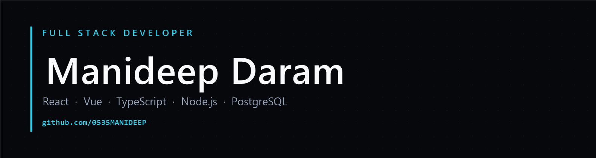

**Full Stack Developer | React · Vue · TypeScript · Node.js · PostgreSQL**

B.Tech CSE May 2024 · 8.53 / 10.0 · Interned on a production risk-management app · Two shipped public projects · Role-based access control enforced at the API, not hidden in the UI

<a href="https://0535manideep.github.io/manideepdaram/">🌐 Portfolio</a> ·
<a href="https://linkedin.com/in/manideep-daram">in LinkedIn</a> ·
<a href="mailto:manideepdaram@gmail.com">✉ Email</a>

---

## About me

I build **end-to-end web applications** in TypeScript — React 19 and Next.js on the front end, Node.js and Express on the back, PostgreSQL underneath. B.Tech in Computer Science, 8.53 CGPA from Vidya Jyothi Institute of Technology, Hyderabad (Aug 2020 – Apr 2024).

Interned for **7 months at Crystalline Software Technologies** — shipped Vue.js screens for a production risk-management SPA, alongside the backend team. I enforce access control at the service layer — the rule comes from the database, not the token. I believe in tests you can open and read. I believe in free-tier deploys, no fantasy pricing.

> I write code you can read to understand. Fewer comments than you expect. More tests than you do.

---

## 📁 Currently working on

> **Open to fresher Full Stack roles** — Hyderabad, remote or hybrid. Bring me a real problem and I'll ship it.

- ✅ **Live** on every host: **TaskFlow** · **DocVault** · **Portfolio**
- 📝 **Coming soon** — browser extension (page-to-Markdown, one click, INR 299 one-time, coming soon to the Chrome Web Store)
- ✍️ **Writing** — two technical posts are shipping for `/writing` (*How I keep two apps green* / *The RBAC pattern: one matrix, two places*)

---

## 🔥 Featured projects

| Project | What it is | Status |
| --- | --- | --- |
| **TaskFlow** — [repo](https://github.com/0535MANIDEEP/taskflow) · [live](https://taskflow-web-rosy.vercel.app) | Full stack task manager — layered services, JWT auth, RBAC at the API, **44 tests** on every push | ✅ Live |
| **DocVault** — [repo](https://github.com/0535MANIDEEP/docvault) · [live](https://docvault-blond-rho.vercel.app) | Document manager with enforced UI+API permissions matrix; **15 tests** on every push | ✅ Live |
| **Portfolio** — [repo](https://github.com/0535MANIDEEP/manideepdaram) · [live](https://0535manideep.github.io/manideepdaram/) | This site, this README — tested, deployed, verified before every push | ✅ Live |

---

## 🛠️ Stack

| Layer | I use |
| --- | --- |
| Language | TypeScript · JavaScript (ES6+) · SQL |
| Frontend | React 19 · Next.js · Vue.js · Tailwind CSS |
| Backend | Node.js · Express · REST APIs · Service layer · Postgres |
| Auth | JWT · bcrypt — rules at the service layer, never buried in the UI |
| Testing | Vitest · Postman · GitHub Actions CI on every push |
| Tooling | Git · Vite · Vercel · GitHub Pages · Neon (free) |

---

## ✍️ Writing & Publication

- [FoodForward: An Initiative to Reduce Food Wastage](https://www.jetir.org/papers/JETIR2404570.pdf) — JETIR, April 2024 (UGC-approved journal)
- Coming soon: *How I keep two apps green on every push* · *The RBAC pattern: one matrix, two places*

---

## 📫 Reach me

<a href="https://linkedin.com/in/manideep-daram">in /manideep-daram</a> ·
<a href="https://0535manideep.github.io/manideepdaram/">manideepdaram</a> ·
<a href="mailto:manideepdaram@gmail.com">manideepdaram@gmail.com</a>

Built on free tiers, pushed to main, tested before deploy.
